<code>UX RESEARCH &amp; DESIGN · EDUCATION / UNIVERSITY WEBSITE · PART 2 OF 2</code>

# CPS Website Redesign 2026

**Easier to find.** Making Northeastern University's College of Professional Studies (CPS) homepage easier to discover, understand and navigate, so prospective students, current students, parents, alumni, faculty and staff can each find where their own path begins.

**[Read the case study ↗](https://hebamoussa.com/work/cps-website-redesign-2026)** · **[Visit the redesign ↗](https://hebamoussa.com/cps-redesign.html)** · **[Download the PDF](https://hebamoussa.com/CPS_Website_Redesign_2026_Case_Study.pdf)** · **[Part 1: the 2025 team study](https://hebamoussa.com/work/cps-website-redesign)**

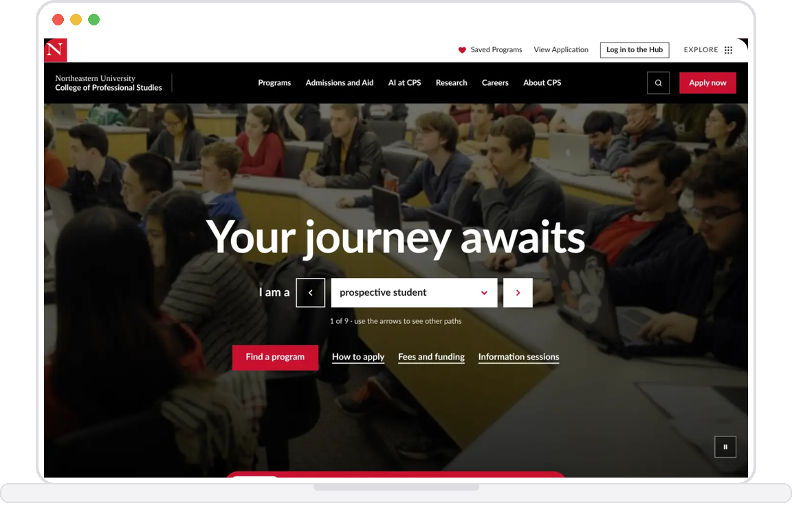

| Role | Delivered | Context |
|---|---|---|
| UX research and design, solo | Audience-first homepage, insider guide, Explore menu, mobile prototype | 2026, continuing the Winter 2025 study I led |

---

## 01 · The problem: nine visitors, one slogan

The CPS homepage treats every visitor the same, so each audience has to work out where their own path begins. The 2025 study I led showed what that costs; this redesign answers it.

| Before: the live homepage | After: my redesign |
|---|---|
| 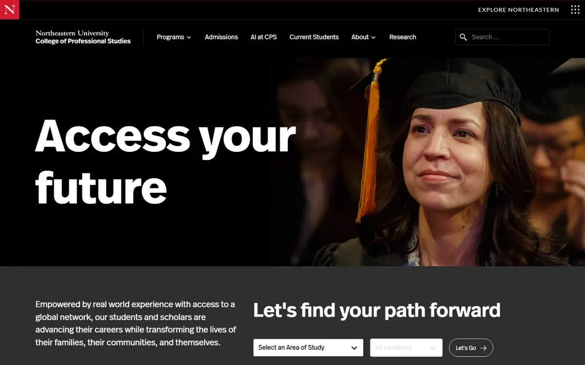 | 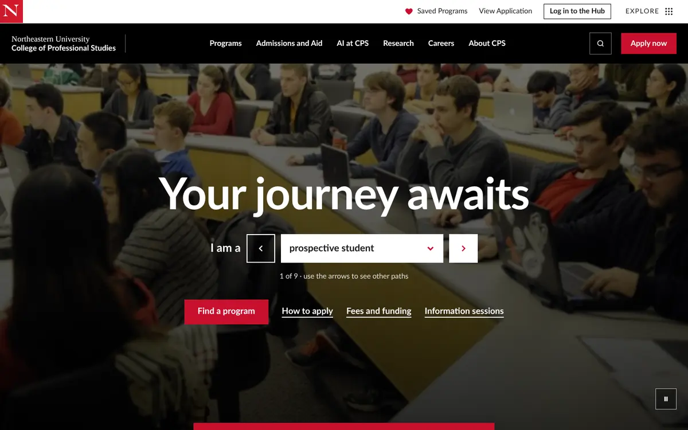 |
| One slogan and a two-filter search. Nothing for current students, parents or alumni. | One question, “I am a…”, routes nine audiences to four first tasks each. The first task is the only red button. |

**What I found**

- **64%** of 2025 survey respondents found the CPS site somewhat difficult or difficult to use *(14 respondents: directional, not representative)*
- **#1** starting challenge in the CPS student experience survey: navigating online resources
- **18,000** Program Finder views in one quarter, nearly twice the homepage's *(Google Analytics, Q2 FY25)*

**How might we…**

1. …let every visitor reach their first task from the first screen?
2. …bring scattered student resources together without a longer menu?
3. …keep the year's biggest change, the move to semesters, in plain sight?

## 02 · Research: six tasks, one live site

- **Six-task walkthrough** of the live homepage: find a program, apply from abroad, check costs, register, book an advisor, become a mentor
- **Current site review:** six problems (header, hero, statistics, semester change, registration, footer), each next to the change I made
- **Competitive analysis** from the 2025 study: Harvard, BU and UMass Amherst
- **2025 survey:** 79% visit for program information, 64% for schedules and calendars
- **Web traffic:** the Program Finder is the real front door; visits averaged under two pages

## 03 · Insights: every round, one wall

After every round I wrote what I had learned on sticky notes. Grouping them showed what to keep, what to drop and who to design for.

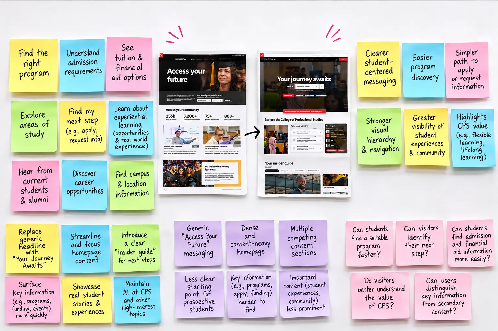

**Primary persona: Priya**, a composite from survey responses and traffic data, plus proto personas for parents, international applicants, alumni and staff. Four pain points, each with a goal and a metric:

| Pain point | Goal | Metric |
|---|---|---|
| “I don't know where my path starts.” | Every visitor reaches their first task from the first screen | First-click success ≥ 80% on six tasks |
| “Everything competes for my attention.” | One primary action per screen; a header people can scan | Time to the Program Finder; clicks on the red button |
| “Student resources live in too many places.” | Every common topic two clicks or fewer from the homepage | Tree-test success ≥ 75% across four groups |
| “I plan everything on my phone.” | The same tasks work as well on a phone | Mobile task success matches desktop; SUS above the current site |

## 04 · Design: structure first, color last

I sketched three directions, mapped the site in [Miro](https://miro.com/app/board/uXjVIVPAp5E=/?share_link_id=504838537006), and drew task flows and wireflows in grayscale, so every review stayed on structure. Color came only after the structure held up.

| Site map sketch | Wireflow: request program information |
|---|---|
| 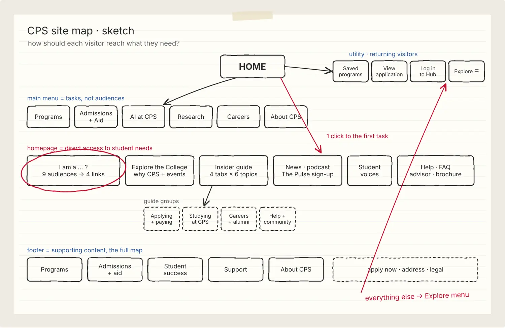 | 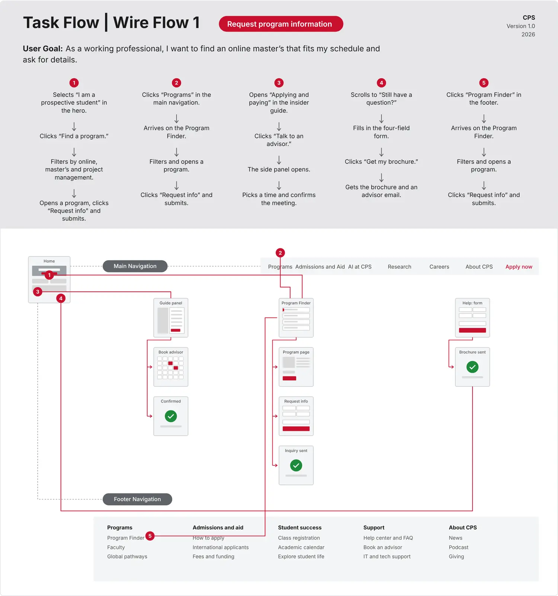 |

**Seven versions, one clear homepage.** Each version was compared with the last. Most improvements came from removing things: a second search, a carousel, extra header links.

| An early version | Audience panels | Version 7 (final) |
|---|---|---|
| 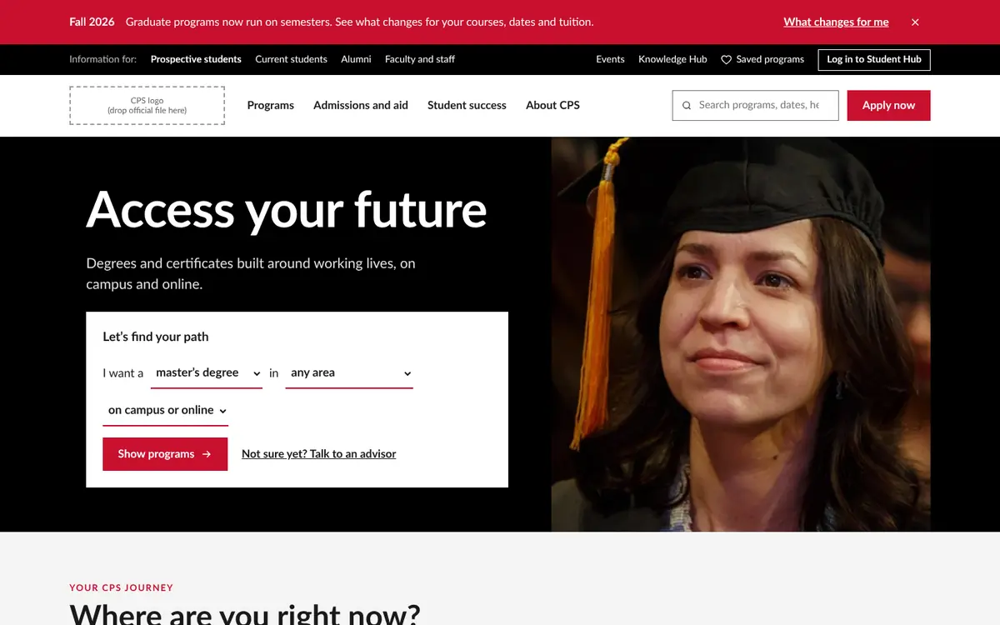 | 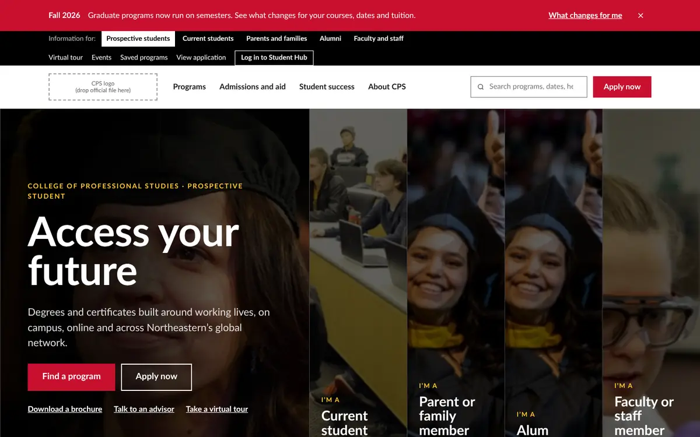 |  |

- **20 → 7** homepage blocks became seven sections
- **17 → 11** header links in two rows, with one red **Apply now**
- **15 topics → 4 tabs × 6 cards** in the insider guide
- **9 audiences, 1 question**

## 05 · The final design

**The insider guide.** Students used to check five places for one answer. The guide gathers applying, paying, studying, careers and help into four tabs, opens on the tab that fits who you said you are, and each card opens a side panel with every link and the next step. On phones it slides up as a sheet.

<table>
  <tr>
    <td width="62%">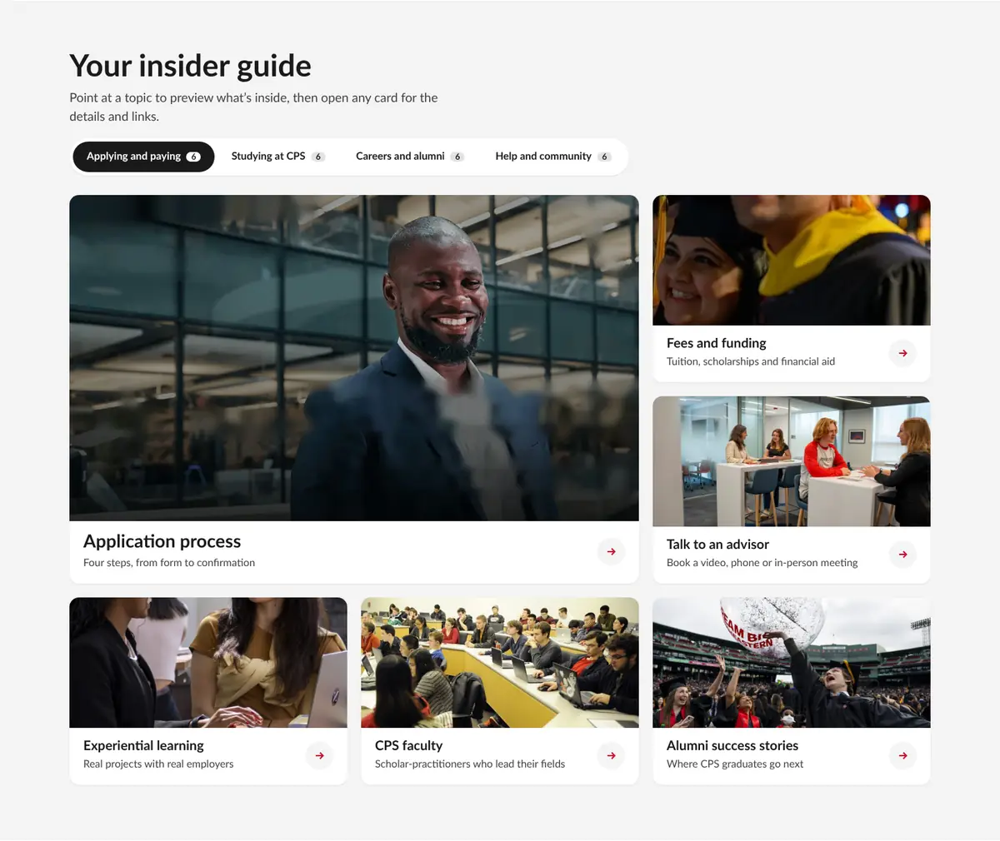</td>
    <td>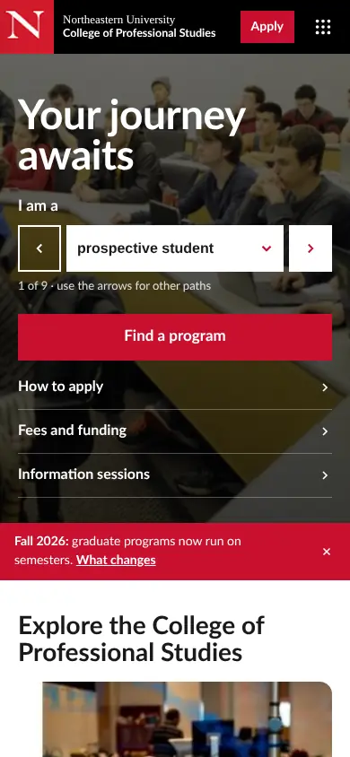</td>
    <td>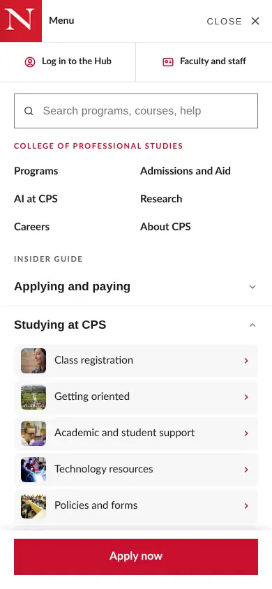</td>
  </tr>
  <tr>
    <td>Insider guide · desktop</td>
    <td>Hero · phone</td>
    <td>Same groups · phone menu</td>
  </tr>
</table>

Also in the final page: a **Fall 2026 alert** on the hero's edge for the move to semesters, **AI at CPS** right after Explore, **Life at CPS** with real Faces of CPS figures, three **student voices**, an answers-only **FAQ**, a **“Need help?” launcher** for ambassador chat, advisor booking or a call, and **Request information** as the closing call to action.

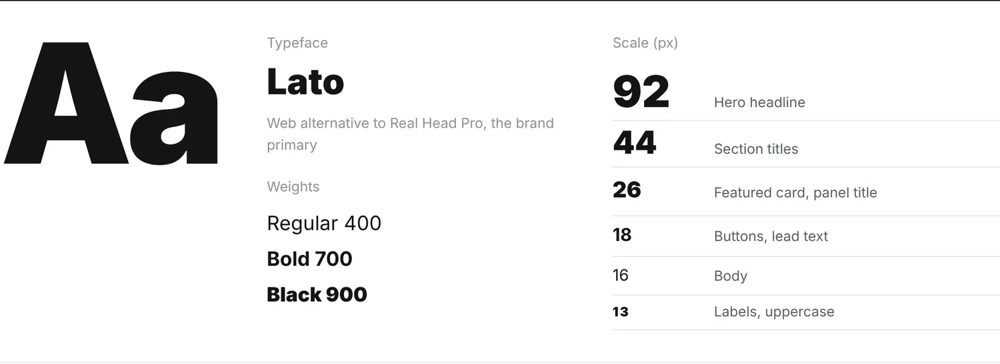

Type: Lato, Northeastern's approved web alternative to its licensed brand font. CPS red is reserved for the one action that matters.

## 06 · Validation: the plan

The redesign has **not yet been tested with users**. I piloted all six tasks myself first and fixed what I found. The recommended next step is a comparative test: five to eight participants try the live homepage and the redesign, in alternating order, on the same six tasks, measuring purpose clarity (5-second test), navigation ease, next-step confidence and SUS.

| # | Visitor | Task |
|---|---|---|
| 1 | Prospective student | Find an online master's in project management and ask for information |
| 2 | International applicant | Find what to prepare before applying from abroad |
| 3 | Parent | Find what the fall term costs and how to pay |
| 4 | Current student | Register for next term's classes |
| 5 | Current student | Book time with an advisor |
| 6 | Alum | Find a way to mentor current students |

## Recommendations for CPS

1. **Ask “I am a…” first:** route nine audiences to their first task from the hero.
2. **One insider guide:** fifteen topics in four tabs, so students stop checking five places.
3. **Keep critical changes in plain sight:** time-sensitive news on the hero's edge.
4. **People one tap away:** a help launcher for ambassador chat, advisor booking and a call on every screen.

**Limitations.** No user testing yet; the pilot is mine; proto personas are assumptions; the survey had 14 respondents; content is sample content; inner pages are low fidelity.

**What I learned.** Most improvements came from removing things. Next time: benchmark first, card-sort the topics, and use original photography.

---

Student project by <a href="https://hebamoussa.com">Heba Moussa</a>, Northeastern University. Not affiliated with or endorsed by the College of Professional Studies; CPS and Northeastern names, logos and photos belong to Northeastern University. · <a href="https://www.linkedin.com/in/heba-moussa-mba/">LinkedIn</a> · <a href="https://hebamoussa.com/work">More case studies</a>
